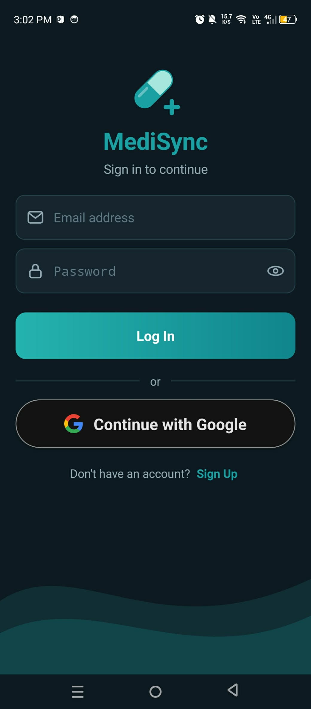
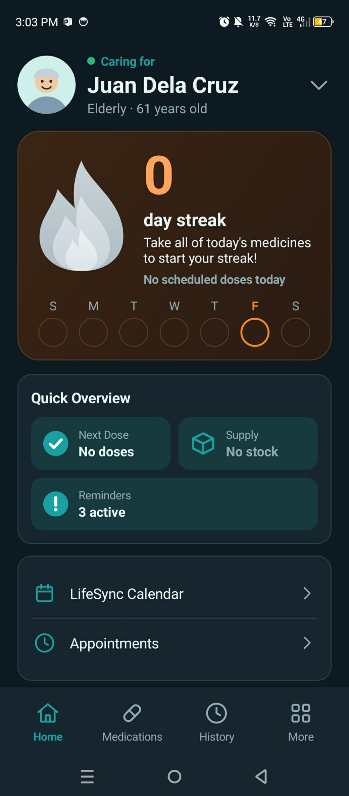
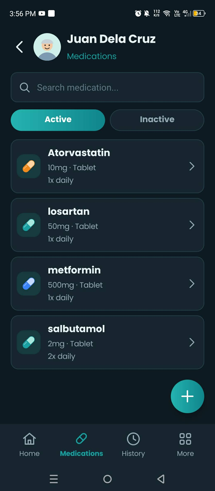
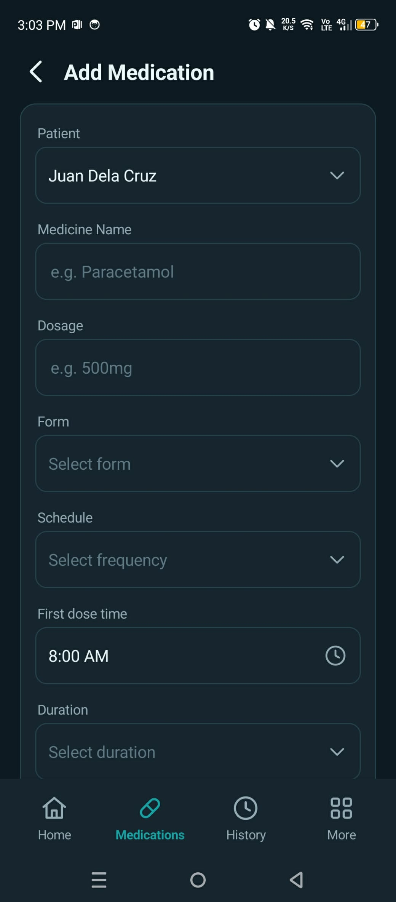
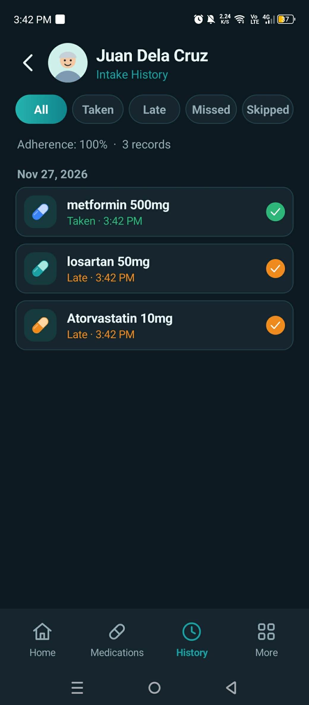
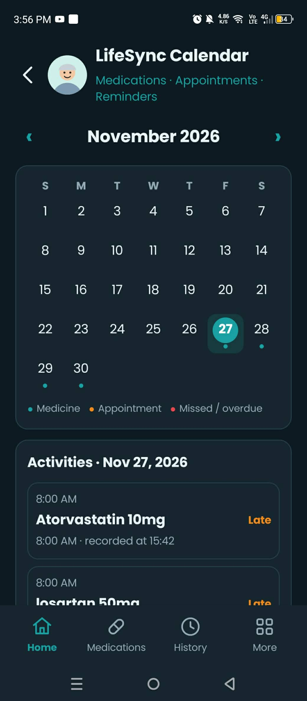
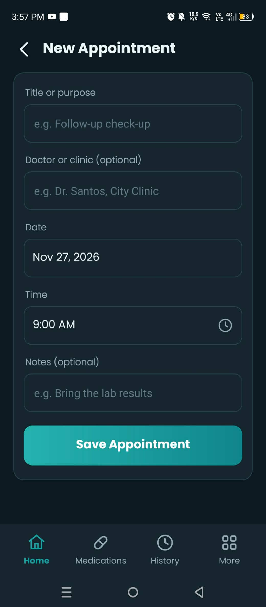
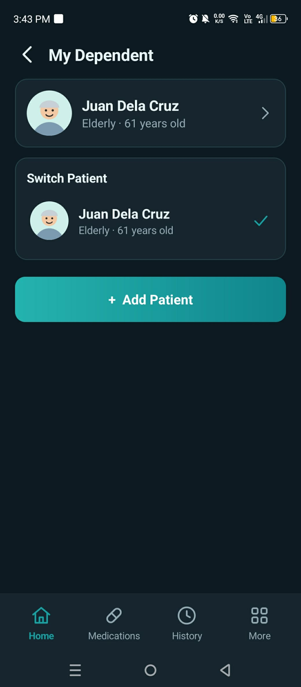

# fineEpal-MediSync

<p align="center">
  
</p>

<h1 align="center">🩺 MediSync</h1>

<h3 align="center">Medication Monitoring and Management System</h3>

<p align="center">
  
</p>

<p align="center">
  A Java-based application designed to help individuals, parents, guardians, and family caregivers organize and monitor medication routines.
</p>

---

## ℞☤ Overview

**MediSync** is a Java-based medication monitoring and management application designed to provide users with a centralized and organized platform for managing their medication needs.

It aims to simplify keeping track of multiple medications by allowing users to:

- 📝 **Record** essential medication information.
- ⏰ **Organize** dosage schedules and receive timely reminders.
- ✅ **Monitor** actual medication intake and maintain intake history.
- 💊 **Track** remaining medicine supplies for timely replenishment.

### 👥 Who Can Use MediSync?

<table>
  <tr>
    <td align="center" width="25%">
      
      <br>
      <b>Individuals</b>
      <br>
      <sub>Self-managing personal medication schedules, intake history, and medicine supplies.</sub>
    </td>
    <td align="center" width="25%">
      
      <br>
      <b>Parents & Guardians</b>
      <br>
      <sub>Family caregivers organizing and overseeing medication routines for their dependents.</sub>
    </td>
    <td align="center" width="25%">
      
      <br>
      <b>Children (10 & Below)</b>
      <br>
      <sub>Young dependents whose dosages and schedules are closely monitored by guardians.</sub>
    </td>
    <td align="center" width="25%">
      
      <br>
      <b>Elderly Individuals</b>
      <br>
      <sub>Senior dependents whose medication accounts are handled and monitored by guardians.</sub>
    </td>
  </tr>
</table>

---

## ℞☤ Key Features

- 💊 **Medication Management** – Allows users to record, organize, and manage essential medication information.
- 🕒 **Medication Scheduling** – Helps users organize dosage schedules and medication routines.
- 📋 **Medication Intake Tracking** – Enables users to record medication intake and monitor taken, missed, or skipped doses.
- 📖 **Medication History** – Maintains records of medication intake for easier monitoring and reference.
- 📦 **Medicine Supply Monitoring** – Helps users monitor remaining medicine quantities and identify when supplies need replenishment.
- 🔔 **Reminders and Notifications** – Supports medication and appointment reminders.
- 👨‍👩‍👧 **Guardian and Caregiver Support** – Allows parents, guardians, and family caregivers to manage medication records and routines on behalf of their dependents.

---

## ℞☤ Technologies Used

- [](https://www.java.com/)
- [](https://en.wikipedia.org/wiki/Object-oriented_programming)
- [](https://developer.android.com/studio)
- [](https://www.w3.org/XML/)

---

## ℞☤ Project Structure

The following directory structure presents the organization of the MediSync application, including its authentication, database, manager, model, receiver, and utility components.

```text

## Project Structure

```text
MediSync/
│
├── app/
│   └── src/
│       ├── main/
│       │   ├── java/
│       │   │   └── com/medisync/app/
│       │   │       ├── auth/
│       │   │       │   ├── EmailVerifier.java
│       │   │       │   ├── GoogleSignIn.java
│       │   │       │   ├── GoogleSignInBase.java
│       │   │       │   └── GoogleSignInFlow.java
│       │   │       │
│       │   │       ├── database/
│       │   │       │   ├── DbAccounts.java
│       │   │       │   ├── DbAppointments.java
│       │   │       │   ├── DbCore.java
│       │   │       │   ├── DbDoses.java
│       │   │       │   ├── DbMeds.java
│       │   │       │   ├── DbPatients.java
│       │   │       │   └── MediSyncDatabase.java
│       │   │       │
│       │   │       ├── manager/
│       │   │       │   ├── AccountStore.java
│       │   │       │   ├── AlarmScheduler.java
│       │   │       │   ├── AuthManager.java
│       │   │       │   ├── CalendarBuilder.java
│       │   │       │   ├── HealthAlertService.java
│       │   │       │   ├── NotificationHelper.java
│       │   │       │   ├── PasswordHasher.java
│       │   │       │   ├── ReminderService.java
│       │   │       │   ├── StreakCalculator.java
│       │   │       │   └── Validator.java
│       │   │       │
│       │   │       ├── model/
│       │   │       │   ├── Appointment.java
│       │   │       │   ├── AppointmentReminder.java
│       │   │       │   ├── CalendarEvent.java
│       │   │       │   ├── HealthAlert.java
│       │   │       │   ├── IntakeRecord.java
│       │   │       │   ├── IntakeStatus.java
│       │   │       │   ├── Medication.java
│       │   │       │   ├── MedicationReminder.java
│       │   │       │   ├── MedicationSchedule.java
│       │   │       │   ├── Patient.java
│       │   │       │   ├── Person.java
│       │   │       │   ├── Reminder.java
│       │   │       │   ├── RestockReminder.java
│       │   │       │   └── User.java
│       │   │       │
│       │   │       ├── receiver/
│       │   │       │   ├── BootReceiver.java
│       │   │       │   └── ReminderReceiver.java
│       │   │       │
│       │   │       └── util/
│       │   │           ├── DateUtils.java
│       │   │           ├── Keys.java
│       │   │           ├── AccountScreens.java
│       │   │           ├── AnimalArt.java
│       │   │           ├── AppHooks.java
│       │   │           ├── AppState.java
│       │   │           ├── AppointmentDetail.java
│       │   │           ├── AppointmentScreen.java
│       │   │           ├── AvatarPicker.java
│       │   │           ├── AvatarView.java
│       │   │           ├── BarView.java
│       │   │           ├── CalendarCells.java
│       │   │           ├── CalendarScreen.java
│       │   │           ├── DependentScreens.java
│       │   │           ├── DoseLogic.java
│       │   │           ├── FlameView.java
│       │   │           ├── FormHelpers.java
│       │   │           ├── FormatHelpers.java
│       │   │           ├── GoogleAuthFlow.java
│       │   │           ├── GoogleAuthUi.java
│       │   │           ├── HelpScreens.java
│       │   │           ├── HistoryScreen.java
│       │   │           ├── HomeAlerts.java
│       │   │           ├── HomeScreen.java
│       │   │           ├── HomeStreak.java
│       │   │           ├── IconView.java
│       │   │           ├── LoginScreens.java
│       │   │           ├── LogoView.java
│       │   │           ├── MainActivity.java
│       │   │           ├── MedFormFields.java
│       │   │           ├── MedFormSave.java
│       │   │           ├── MedFormState.java
│       │   │           ├── MedListScreen.java
│       │   │           ├── MoreScreen.java
│       │   │           ├── Navigation.java
│       │   │           ├── OnboardingScreens.java
│       │   │           ├── PatientScreen.java
│       │   │           ├── PersonArt.java
│       │   │           ├── PhotoStorage.java
│       │   │           ├── ReminderSettings.java
│       │   │           ├── SessionRestore.java
│       │   │           ├── SplashScreen.java
│       │   │           ├── StreakAboutScreens.java
│       │   │           ├── UiBasics.java
│       │   │           ├── UiDialogs.java
│       │   │           ├── UiInputs.java
│       │   │           ├── VerifyScreens.java
│       │   │           └── WaveView.java
│       │   │
│       │   ├── res/
│       │   │   ├── drawable/
│       │   │   │   ├── ic_google_logo.xml
│       │   │   │   └── ic_launcher_foreground.xml
│       │   │   ├── layout/
│       │   │   │   └── activity_main.xml
│       │   │   ├── mipmap-anydpi-v26/
│       │   │   │   ├── ic_launcher.xml
│       │   │   │   └── ic_launcher_round.xml
│       │   │   ├── mipmap-mdpi/
│       │   │   │   ├── ic_launcher.xml
│       │   │   │   └── ic_launcher_round.xml
│       │   │   └── values/
│       │   │       ├── ic_launcher_background.xml
│       │   │       ├── strings.xml
│       │   │       └── styles.xml
│       │   │
│       │   └── AndroidManifest.xml
│       │
│       └── test/
│           └── java/com/medisync/app/
│               └── DomainTests.java
├── gradle/
│   └── wrapper/
│       ├── gradle-wrapper.jar
│       ├── gradle-wrapper.properties
│       └── gradle-daemon-jvm.properties
│
├── .gitignore
├── build.gradle
├── gradle.properties
├── gradlew
├── gradlew.bat
├── settings.gradle
│
├── assets/
│   ├── add_medication.jpg
│   ├── amber.jpg
│   ├── appointment.jpg
│   ├── calendar_and_reminders.jpg
│   ├── dependent.jpg
│   ├── home_dashboard.jpg
│   ├── login_screen.jpg
│   ├── medication_history.jpg
│   ├── medication_list.jpg
│   ├── medisync-banner.jpg
│   ├── seanjerseyalbo.png
│   └── sharmilaroa.jpg
└── README.md

```

### ℞☤ Core Classes

The following classes represent the main components of MediSync, organized according to their respective packages and responsibilities.

#### Model Package

| Class | Responsibility |
| :--- | :--- |
| `User` | Represents a MediSync user and stores account-related information. |
| `Person` | Represents a person within the application. |
| `Patient` | Represents a patient whose medication information and routines are managed. |
| `Medication` | Stores and manages medication details. |
| `MedicationSchedule` | Represents medication schedules and dosage timing. |
| `IntakeRecord` | Records actual medication intake and maintains intake history. |
| `IntakeStatus` | Represents the status of medication intake. |
| `Appointment` | Stores and manages medical appointments. |
| `Reminder` | Represents the general reminder component. |
| `MedicationReminder` | Represents medication-related reminders. |
| `AppointmentReminder` | Represents appointment-related reminders. |
| `RestockReminder` | Represents reminders for medicine supply replenishment. |
| `HealthAlert` | Represents health-related alerts. |
| `CalendarEvent` | Represents events displayed in the application calendar. |

#### Database Package

| Class | Responsibility |
| :--- | :--- |
| `MediSyncDatabase` | Serves as the main database component. |
| `DbCore` | Handles core database operations. |
| `DbAccounts` | Handles account-related database operations. |
| `DbPatients` | Handles patient-related database operations. |
| `DbMeds` | Handles medication-related database operations. |
| `DbDoses` | Handles dose-related database operations. |
| `DbAppointments` | Handles appointment-related database operations. |

#### Manager Package

| Class | Responsibility |
| :--- | :--- |
| `AccountStore` | Manages account information and storage. |
| `AlarmScheduler` | Handles the scheduling of application alarms. |
| `AuthManager` | Manages authentication-related operations. |
| `CalendarBuilder` | Handles calendar event organization and construction. |
| `HealthAlertService` | Manages health-related alerts. |
| `NotificationHelper` | Handles application notifications. |
| `PasswordHasher` | Handles password hashing operations. |
| `ReminderService` | Manages reminder-related operations. |
| `StreakCalculator` | Calculates medication-related streaks. |
| `Validator` | Handles validation of user inputs. |

#### Authentication Package

| Class | Responsibility |
| :--- | :--- |
| `EmailVerifier` | Handles email verification functionality. |
| `GoogleSignIn` | Handles Google sign-in functionality. |
| `GoogleSignInBase` | Provides base components for Google sign-in. |
| `GoogleSignInFlow` | Handles the Google sign-in process. |

#### Receiver Package

| Class | Responsibility |
| :--- | :--- |
| `BootReceiver` | Handles boot-related broadcast events. |
| `ReminderReceiver` | Handles reminder-related broadcast events. |

---

## ℞☤ UML Class Diagram

The UML Class Diagram illustrates the structure of MediSync, including its major classes, attributes, methods, and relationships. It provides a visual representation of how the different components interact within the application.

<p align="center">
  
</p>

<p align="center">
  <i>Figure 1. UML Class Diagram of MediSync</i>
</p>

---

## ℞☤ Object-Oriented Programming Concepts

MediSync applies Object-Oriented Programming principles and Java features to organize its components, ensure a modular application structure, and handle data efficiently.

- **Classes and Objects:** Classes represent users, medications, schedules, intake records, appointments, and reminders, while objects represent their actual runtime instances used by the system.

- **Methods:** Methods are used for system actions such as adding medications, managing schedules, recording intake, updating supplies, and processing appointments.

- **Encapsulation:** Important data such as user information, medication dosages, quantities, and other records are organized within classes and accessed through designated methods.

- **Inheritance:** A general base class can establish structural relationships between related components and support code reuse where appropriate.

- **Polymorphism:** Polymorphism allows objects from related classes to be treated through a common parent class or interface while providing their own specific implementations. For example, different types of reminders may share common reminder behavior while providing different messages, conditions, and actions.

- **Abstraction:** Abstraction defines common behaviors for related system components, such as notification or reminder functions, while hiding unnecessary implementation details.

- **Exception Handling:** Exception handling helps manage invalid inputs, incorrect data formats, empty fields, invalid dosage or quantity values, and other runtime errors.

- **Arrays/Data Handling:** Arrays and appropriate data structures help store, organize, and manage collections of medications, schedules, intake records, and other related system information.

---

## ℞☤ Getting Started

### Prerequisites

Before running the application, make sure you have:

- Java Development Kit (JDK) installed.
- Android Studio installed.
- An Android emulator or compatible Android device.
- The MediSync project files.
- The required project configuration and dependencies.

### Installation

1. Clone the repository:

```bash
git clone https://github.com/fineEpal/MediSync.git
```

2. Open Android Studio.

3. Select **Open** and locate the downloaded MediSync project folder.

4. Wait for Gradle synchronization to finish.

5. Connect an Android device or start an Android emulator.

6. Select the application run configuration.

7. Click the **Run** button in Android Studio to build and launch MediSync.

---

## ℞☤ Application Screenshots and Highlights

Explore the interface and major functionalities of MediSync through the following application screenshots.

### Authentication and Dashboard

<table>
  <tr>
    <td align="center" width="50%">
      
      <br>
      <b>Login Screen</b>
      <br>
      <sub>Allows users to access their MediSync accounts.</sub>
    </td>
    <td align="center" width="50%">
      
      <br>
      <b>Home Dashboard</b>
      <br>
      <sub>Displays important medication information and application highlights.</sub>
    </td>
  </tr>
</table>

### Medication Management

<table>
  <tr>
    <td align="center" width="50%">
      
      <br>
      <b>Medication List</b>
      <br>
      <sub>Displays the user's recorded medications.</sub>
    </td>
    <td align="center" width="50%">
      
      <br>
      <b>Add Medication</b>
      <br>
      <sub>Allows users to record essential medication information.</sub>
    </td>
  </tr>
</table>

### Medication Monitoring

<table>
  <tr>
    <td align="center" width="50%">
      
      <br>
      <b>Medication History</b>
      <br>
      <sub>Displays recorded medication intake and related history.</sub>
    </td>
    <td align="center" width="50%">
      
      <br>
      <b>Calendar and Reminders</b>
      <br>
      <sub>Provides an organized view of scheduled events and reminders.</sub>
    </td>
  </tr>
</table>

### Additional Application Highlights

<table>
  <tr>
    <td align="center" width="50%">
      
      <br>
      <b>Appointment Management</b>
      <br>
      <sub>Helps users organize their medical appointments.</sub>
    </td>
    <td align="center" width="50%">
      
      <br>
      <b>Guardian and Dependent Management</b>
      <br>
      <sub>Supports the management of medication routines for dependents.</sub>
    </td>
  </tr>
</table>

<p align="center">
  <i>Figure 2. MediSync Application Screenshots and Highlights</i>
</p>

---

## ℞☤ Project Objectives

MediSync aims to:

- Provide an organized platform for managing medication information.
- Help users maintain consistent medication schedules.
- Allow monitoring and documentation of actual medication intake.
- Support parents, guardians, and caregivers in managing dependents' medication routines.
- Help users monitor remaining medicine supplies.
- Encourage responsible medication management and health awareness.

---

## ℞☤ Project Limitations

MediSync is intended for medication organization and monitoring purposes only. It does not provide medical diagnoses, prescribe medications, recommend treatments, or replace professional medical advice.

The accuracy of the information and records depends on the details entered by users. Medication reminders also depend on the application's configuration and availability.

---

## ℞☤ Sustainable Development Goal

<p align="center">
  <a href="https://sdgs.un.org/goals/goal3">
    
  </a>
</p>

**MediSync** contributes to **Sustainable Development Goal 3 (Good Health and Well-Being)** by:

- 💊 Promoting responsible medication management.
- ⏰ Supporting consistent health-related routines.
- 📋 Helping individuals and caregivers monitor medication intake.

---

## ℞☤ Meet the Developers

<p align="center">
  Meet the team behind MediSync, a medication monitoring and management application developed with the goal of supporting organized medication routines.
</p>

<table align="center">
  <tr>
    <td align="center" width="33%">
      
      <br>
     <sub><b>Sean Jersey A. Albo</b></sub>
      <br>
      <sub>BS Computer Science</sub>
    </td>

  <td align="center" width="33%">
      
      <br>
      <sub><b>Amber Sofia C. Ramos</b></sub>
      <br>
      <sub>BS Computer Science</sub>
    </td>
    
   <td align="center" width="33%">
      
      <br>
     <sub><b>Sharmila C. Roa</b></sub>
      <br>
      <sub>BS Computer Science</sub>
    </td>
  </tr>
</table>

<p align="center">
  <b>Batangas State University – The National Engineering University</b>
  <br>
  College of Informatics and Computing Sciences
  <br>
  Alangilan Campus
</p>

---

## ℞☤ Acknowledgment

The development of MediSync would not have been possible without the guidance, support, and encouragement of the people who contributed to this project.

We would like to express our sincere gratitude to our instructor, Ms. Fatima Marie P. Agdon, for providing valuable guidance, knowledge, and feedback throughout the development process.

We also extend our appreciation to our university, classmates, and everyone who supported us in completing this project.

Above all, we are grateful for the opportunity to apply our knowledge and skills in developing a system that promotes responsible medication management and health awareness.

---

<h2 align="center">💚 Thank You for Exploring MediSync!</h2>

<p align="center">
  Thank you for taking the time to explore our project.
  We hope MediSync demonstrates how technology can help
  make medication management more organized and accessible.
</p>

<h3 align="center">MEDISYNC</h3>

<p align="center">
  
</p>

<p align="center">
  <i>Made with dedication by the MediSync Development Team.</i>
</p>

---
